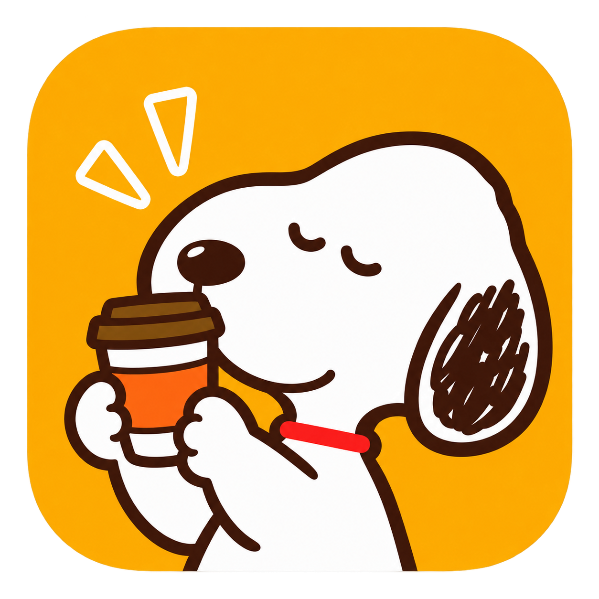
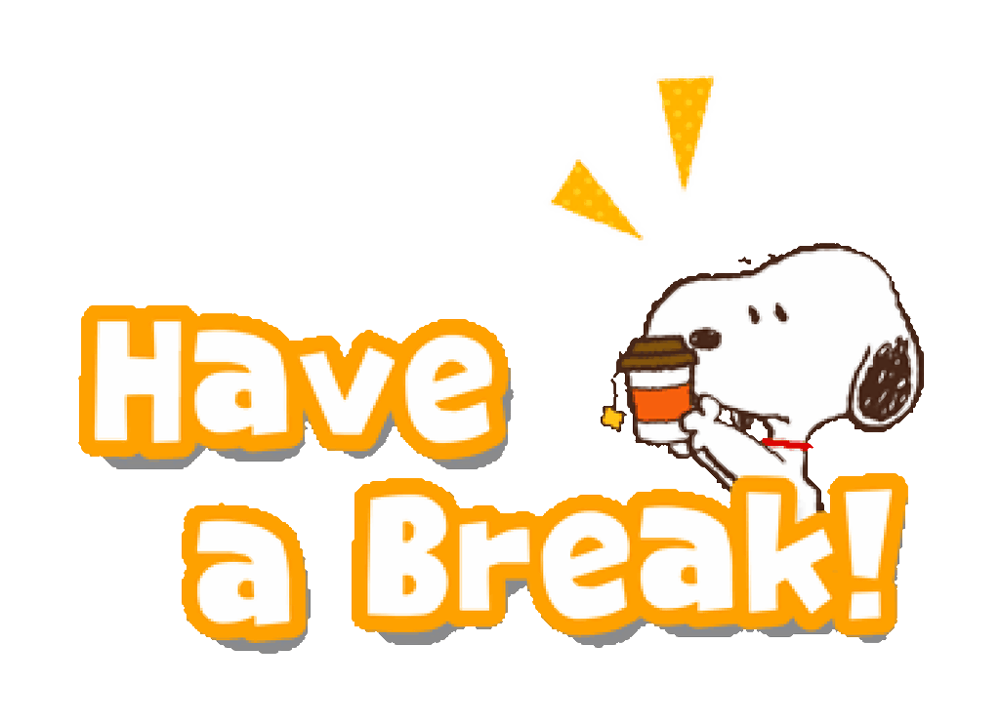
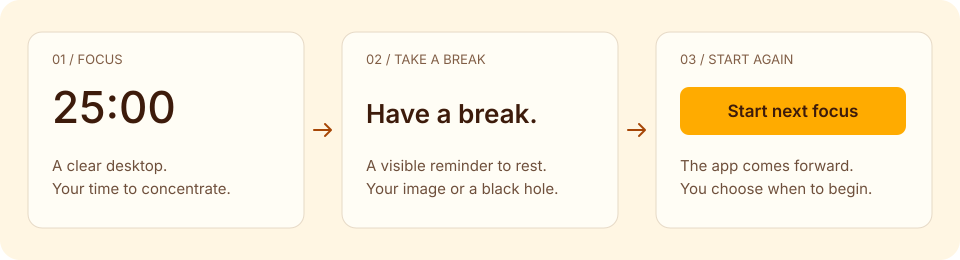

<p align="center">
  
</p>

# Focused Break

**Focus on your work. Take your breaks seriously.**

A small native Mac app that turns your break reminder into something you can see across your desktop. Work with a clear screen, then let a moving image or black hole interrupt your surroundings when it is time to rest.

[Download the latest release](https://github.com/alialfredji/focused-break/releases/latest) · [How to use it](docs/USAGE.md) · [Installation](docs/INSTALL.md) · [Privacy](docs/PRIVACY.md)

<p align="center">
  
</p>

## What it does

- Focus sessions from **2 to 120 minutes**. Durations are always shown in minutes.
- A visible break reminder: the bundled **Have a break** animation, a **black hole**, or **your own image or GIF**.
- Optional desktop distortion that bends your actual screen around the reminder.
- A protected start to each break: choose **5–300 seconds** before Pause and End become available. You can always quit the app.
- The app returns to the front when a break ends, ready for you to start your next focus session.
- A quiet menu-bar timer, saved settings and image, reduced motion, and a **10-second desktop test**.

No account. No subscription. No server. Built with SwiftUI, AppKit, and Metal.



## Install

Requires **macOS 14 or later** and a Metal-capable Mac.

| Your Mac | Download |
| --- | --- |
| Apple Silicon (M1 or later) | [Apple Silicon DMG](https://github.com/alialfredji/focused-break/releases/latest/download/Focused-Break-macOS-arm64.dmg) |
| Intel | [Intel DMG](https://github.com/alialfredji/focused-break/releases/latest/download/Focused-Break-macOS-x86_64.dmg) |

Open the disk image, drag **Focused Break** into **Applications**, then open it. ZIP archives and SHA-256 checksums are also available on the release page.

**First launch:** these early releases are ad-hoc signed, not Apple-notarized. If macOS blocks the app, follow the app-specific **Open Anyway** steps in [Installation](docs/INSTALL.md). You do not need to disable Gatekeeper.

## Your first session

1. Choose **Focus time**, **Break time**, and **End break after**.
2. In **Break appearance**, choose your visual and size. Turn on **Distort desktop** if you want the screen itself to bend; macOS will ask for screen-recording access.
3. Open **Preview** to see the effect, or use **Test on desktop · 10s**.
4. Press **Start focus**. When your focus time ends, the break appears.
5. When the break finishes, Focused Break opens in front. Press **Start next focus** when you are ready.

**Fine-tune** contains presets and detailed effect sliders. You can leave it closed for everyday use. Closing the window keeps the timer running; quit from the app or menu bar to exit.

The effect is click-through: it is a visible interruption, not a computer lock. [Read the full guide](docs/USAGE.md).

## Build from source

Install Xcode Command Line Tools (Swift 5.9 or later), then:

```sh
git clone https://github.com/alialfredji/focused-break.git
cd focused-break
swift test
bash scripts/build.sh
open "dist/Focused Break.app"
```

No third-party package dependencies are required. Builds target the current Mac architecture. [Development and release guide](docs/DEVELOPMENT.md).

## Privacy and limits

Settings and your uploaded image stay on your Mac. Desktop distortion uses transient screen frames locally; it does not upload or save a screen recording. Screen access is optional for the basic reminder. [Permission and storage details](docs/PRIVACY.md).

Protected video can appear blank in desktop capture. Performance and behavior across multiple displays, Spaces, and fullscreen apps can vary. Reduced motion stops travel and GIF playback, but the break still grows and shrinks. Releases are built and tested on both architectures in GitHub Actions; broader real-device testing is still needed.

## Artwork and contributions

The dog logo and bundled animation are included with the app. See [artwork provenance](docs/ARTWORK.md) before reusing them. No third-party character rights or artwork license are claimed. This repository does not currently grant an open-source license.

Found a bug? [Open an issue](https://github.com/alialfredji/focused-break/issues) with your macOS version, Mac chip, app version, and steps to reproduce. Avoid including private screen content.
